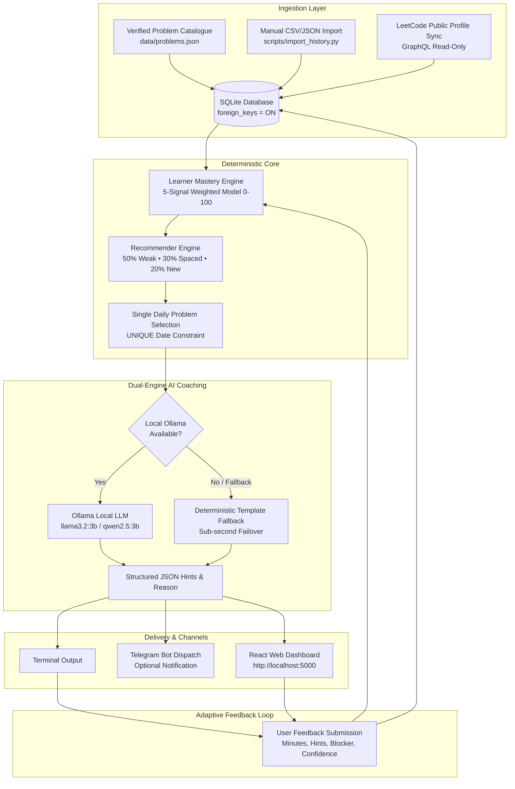

# 🤖 Agentic DSA Mentor

[](https://www.python.org/)
[](https://www.sqlite.org/)
[](https://react.dev/)
[](https://vitejs.dev/)
[](https://ollama.ai/)
[]()
[]()
[]()

> **An autonomous, zero-recurring-cost agentic system that syncs your LeetCode practice history, models multi-signal topic mastery, deterministically recommends exactly ONE optimal unsolved problem per day, delivers it with evidence-based reasoning and progressive hint ladders via local Ollama models (with instant deterministic offline fallback), captures structured feedback, and continuously adapts future practice.**

---

## 📑 Table of Contents
- [Why Agentic DSA Mentor?](#-why-agentic-dsa-mentor)
- [Key Architectural Highlights](#-key-architectural-highlights)
- [System Architecture](#-system-architecture)
- [Core Features](#-core-features)
- [Benchmark Metrics & Portfolio Proof](#-benchmark-metrics--portfolio-proof)
- [Tech Stack](#-tech-stack)
- [Repository Structure](#-repository-structure)
- [Quick Start Guide](#-quick-start-guide)
  - [1. Prerequisites](#1-prerequisites)
  - [2. Clone & Virtual Environment](#2-clone--virtual-environment)
  - [3. Configure Environment](#3-configure-environment)
  - [4. Database & Catalogue Initialization](#4-database--catalogue-initialization)
  - [5. Run Daily Recommendation](#5-run-daily-recommendation)
  - [6. Launch Web Dashboard](#6-launch-web-dashboard)
  - [7. Docker Compose Setup](#7-docker-compose-setup-optional)
- [End-to-End Demo Walkthrough](#-end-to-end-demo-walkthrough)
- [Testing & Quality Assurance](#-testing--quality-assurance)
- [Privacy, Security & Hard Stops](#-privacy-security--hard-stops)
- [Deep-Dive Documentation](#-deep-dive-documentation)

---

## 💡 Why Agentic DSA Mentor?

Most software engineers tackling Data Structures & Algorithms (DSA) face three chronic issues:
1. **Decision Paralysis & Grinding Burnout**: Endless problem lists (NeetCode 150, Blind 75, Striver's SDE sheet) without personalized pacing lead to erratic jumping between topics.
2. **Premature Solution Peeking**: Looking at LeetCode discussion forums reveals the whole solution immediately, destroying the cognitive struggle required for deep retention.
3. **Expensive or Privacy-Invasive Tools**: Cloud-based AI tutors charge monthly subscriptions and require storing session cookies, passwords, or personal data on remote third-party servers.

**Agentic DSA Mentor solves this permanently** with a local-first, privacy-respecting, zero-cost architecture:
- Recommends **strictly ONE problem per day**, chosen mathematically to target your highest-leverage growth areas.
- Provides a **progressive 3-tier hint ladder** (gentle nudge ➡️ pattern clue ➡️ approach outline) without spoiling the code.
- Operates **100% on your machine** using SQLite and local Ollama inference (`llama3.2:3b`, `qwen2.5:3b`, or `deepseek-r1:1.5b`), with zero external dependencies and zero recurring fees.

---

## ⚡ Key Architectural Highlights

- 🎯 **100% Deterministic Core**: Problem selection, multi-signal scoring, topic mastery calculations, and idempotency are strictly governed by deterministic Python algorithms. The LLM is an explanatory coach—it never hallucinates or decides problems, URLs, difficulties, or tags.
- 🛡️ **Dual-Engine Resilience & Sub-Second Fallback**: When local Ollama is active, it formats rich structured JSON hint ladders. If the LLM daemon is offline, a deterministic template engine takes over seamlessly with `< 1.0s` failover and zero crashes.
- 🔒 **Absolute Privacy & Zero-Cloud Invariant**: No passwords, no session cookies (`LEETCODE_SESSION`), and no CSRF tokens are ever requested or stored. Syncing is read-only via public GraphQL profiles or manual CSV/JSON import.
- 🔁 **Guaranteed 0.0% Repeat Rate & Idempotency**: An append-only SQLite store with `UNIQUE(date)` constraints guarantees exactly one recommendation per calendar day and strictly filters out already-solved problems.
- 🧠 **5-Signal Adaptive Recalibration**: Incorporates solve time, hint reliance, perceived difficulty, confidence (1–5), and error blocker category to dynamically recalibrate topic mastery and difficulty thresholds.
- 💻 **Modern Web Dashboard**: Responsive React 18 + Vite SPA featuring progressive hint disclosure, topic mastery radars, live activity timeline, and feedback submission forms (bound strictly to `localhost`).

---

## 🏗️ System Architecture



*For comprehensive architecture specifications, threat modeling, and data flow diagrams, see [docs/architecture.md](dsa-mentor-ai/docs/architecture.md).*

---

## ✨ Core Features

| Feature | Description |
|---|---|
| **5-Signal Topic Mastery** | Mathematical mastery score `[0-100]` per topic based on `0.30*success + 0.20*recency + 0.20*difficulty + 0.15*low_hint + 0.15*confidence`, with proportional redistribution for sparse history. |
| **3-Bucket Candidate Balancing** | Dynamic allocation across **50% Weak-Topic Remediations**, **30% Spaced Revision**, and **20% Novel Pattern Expansion**. |
| **Progressive Hint Ladder** | 3-step structured guidance: **Hint 1 (Conceptual Nudge)** ➡️ **Hint 2 (Pattern & Invariant Clue)** ➡️ **Hint 3 (Algorithmic Approach Outline)**. |
| **Offline Snapshot Caching** | Public profile sync automatically caches sanitized JSON snapshots to `data/snapshots/` for full offline functionality. |
| **Windows Task Scheduler** | Automated daily background execution via PowerShell script (`scripts/register_task.ps1`) with run-at-next-login resilience. |
| **Telegram Bot Integration** | Dispatches formatted daily recommendations and listens for `/today`, `/hint`, and `/status` commands directly on your phone. |
| **30-Day Health Metrics** | Rolling 30-day analytics tracking completion rate, 0% repeat rate, difficulty distribution, and system reliability (`scripts/metrics_30day.py`). |
| **Atomic Database Backups** | Online SQLite atomic backup script with checksum verification (`scripts/backup_db.py`). |

---

## 📊 Benchmark Metrics & Portfolio Proof

All metrics reflect verified system test benchmarks across **43 automated unit, integration, and end-to-end acceptance tests**:

- **Daily Pick Idempotency**: `100.0%` (Guaranteed exactly 1 problem per day via database `UNIQUE(date)` constraint; repeated invocations return identical record).
- **Problem Repeat Rate**: `0.0%` (Strictly filters out previously solved or imported problems).
- **Import Deduplication**: `100.0%` deduplication strictly by stable `problem_id` (never by mutable titles).
- **Offline Fallback Latency**: `< 1.0s` (Automatic template fallback when local LLM daemon is offline).
- **Test Suite Pass Rate**: `43 / 43` tests passing (100% green across data layer, learner model, recommender, feedback, mentor, API, and scheduler).

---

## 🛠️ Tech Stack

- **Backend & Logic**: Python 3.12, SQLite 3, Flask, Requests, Pytest
- **AI & Coaching**: Local Ollama (`llama3.2:3b` / `qwen2.5:3b` / `deepseek-r1:1.5b`), Pydantic / JSON schema validation
- **Frontend Dashboard**: React 18, Vite 6, Native CSS (zero external CDNs or remote tracking pixels)
- **Scheduling & Automation**: Windows Task Scheduler (`register_task.ps1`), Python `threading`, Asia/Kolkata timezone support
- **Containerization**: Multi-stage Docker, Docker Compose (local host binding only)

---

## 📂 Repository Structure

```text
leetcode/
├── README.md                           # Main repository overview & portfolio documentation
├── dsa-mentor-ai/                      # Core project package
│   ├── app/                            # Backend services and deterministic core
│   │   ├── __init__.py
│   │   ├── api.py                      # Localhost Flask REST API & static dashboard host
│   │   ├── catalogue.py                # Verified problem catalogue query service
│   │   ├── config.py                   # Environment config & secret-scrubbing logger
│   │   ├── db.py                       # SQLite connection factory (foreign_keys=ON)
│   │   ├── feedback.py                 # Feedback capture & adaptive recalibration
│   │   ├── importer.py                 # CSV/JSON history importer with problem_id deduplication
│   │   ├── learner_model.py            # 5-signal weighted topic mastery engine (0-100)
│   │   ├── leetcode_client.py          # Read-only public GraphQL sync with snapshot fallback
│   │   ├── mentor.py                   # Local Ollama AI coach with template fallback
│   │   ├── notifier.py                 # Terminal and Telegram delivery with retry logic
│   │   ├── pattern_analyzer.py         # Canonical DSA taxonomy tracking & pattern gaps
│   │   └── scheduler_job.py            # Daily pipeline orchestrator
│   ├── dashboard/                      # React 18 + Vite local web dashboard
│   │   ├── src/
│   │   │   ├── App.jsx                 # Dashboard views, hint reveal ladder, feedback form
│   │   │   ├── index.css               # Clean, accessible dark theme CSS
│   │   │   └── main.jsx
│   │   ├── package.json
│   │   └── vite.config.js
│   ├── data/
│   │   ├── problems.json               # Curated starter catalogue (36 verified problems)
│   │   └── snapshots/                  # Scrubbed offline LeetCode profile snapshots
│   ├── database/
│   │   └── schema.sql                  # SQLite schema with foreign keys and unique constraints
│   ├── docs/                           # In-depth architectural & operational documentation
│   │   ├── architecture.md             # System architecture & component interaction flows
│   │   ├── demo_walkthrough.md         # Step-by-step interactive demo script
│   │   ├── limitations.md              # Sizing guidelines, model choices & rate limits
│   │   └── privacy_notes.md            # Zero-cloud guarantees & secret scrubbing
│   ├── scripts/                        # Production operations & CLI utilities
│   │   ├── backup_db.py                # Atomic SQLite online backup utility
│   │   ├── feedback_cli.py             # Interactive CLI feedback capture tool
│   │   ├── import_history.py           # CLI tool to ingest solved CSV/JSON history
│   │   ├── metrics_30day.py            # Rolling 30-day performance & health metrics
│   │   ├── register_task.ps1           # Windows Task Scheduler automation registration
│   │   ├── run_daily.py                # Daily pipeline execution entrypoint
│   │   ├── telegram_bot.py             # Interactive Telegram polling bot
│   │   └── weekly_report.py            # Weekly progress, strengths & priorities report
│   ├── tests/                          # 43 automated unit & acceptance tests
│   ├── Dockerfile                      # Multi-stage local container packaging
│   ├── docker-compose.yml              # Localhost-bound compose orchestration
│   ├── pytest.ini                      # Pytest configuration
│   ├── requirements.txt                # Python dependencies
│   ├── PROGRESS.md                     # Implementation roadmap & Ponytail debt ledger
│   └── BLOCKERS.md                     # Blocker log & resolution record
```

---

## 🚀 Quick Start Guide

### 1. Prerequisites
- **Python**: Version `3.10+` (3.12 recommended)
- **Node.js**: Version `18+` (for building the local web dashboard)
- **Ollama (Optional)**: Install from [ollama.ai](https://ollama.ai/) and run `ollama pull llama3.2:3b`. *(If absent, the system automatically uses its deterministic fallback engine).*

### 2. Clone & Virtual Environment
```bash
git clone https://github.com/avito46/Agentic-DSA-Mentor.git
cd Agentic-DSA-Mentor/dsa-mentor-ai

# Create and activate virtual environment
python -m venv .venv

# On Windows:
.venv\Scripts\activate
# On Linux / macOS:
# source .venv/bin/activate

# Install Python dependencies
pip install -r requirements.txt
```

### 3. Configure Environment
```bash
cp .env.example .env
```
Edit `.env` with your settings:
```ini
LEETCODE_USERNAME=YourLeetCodeUsername
OLLAMA_MODEL=llama3.2:3b
TIMEZONE=Asia/Kolkata

# Optional Telegram notifications:
TELEGRAM_BOT_TOKEN=
TELEGRAM_CHAT_ID=
```

### 4. Database & Catalogue Initialization
```bash
python -c "from app.db import init_db; from app.catalogue import load_catalogue; init_db(); load_catalogue()"
```
*This initializes SQLite at `database/dsa_mentor.db` with enforced foreign keys and loads the 36-problem verified starter catalogue.*

### 5. Run Daily Recommendation
```bash
# Run pipeline with terminal delivery (skipping external sync/telegram)
python scripts/run_daily.py --no-sync --no-telegram
```
*The engine calculates your topic mastery, deterministically selects today's optimal unsolved problem, generates the 3-step hint ladder, and displays the daily brief in your terminal.*

### 6. Launch Web Dashboard
```bash
# 1. Build the React dashboard frontend
cd dashboard
npm install
npm run build
cd ..

# 2. Start localhost API server
python -m app.api
```
Open **[http://localhost:5000](http://localhost:5000)** in your browser to:
- View today's target problem and selection rationale.
- Progressively reveal Hint 1, Hint 2, and Hint 3 on demand.
- Inspect your topic mastery radar and weak-area alerts.
- Submit session feedback (solve time, hints used, perceived difficulty, blocker category).

*(For hot-reloading frontend development, run `npm run dev` inside `./dashboard` to open `http://localhost:5173` with proxying to port 5000).*

### 7. Docker Compose Setup (Optional)
```bash
# Build and run completely inside isolated local container
docker-compose up --build
```
Access the dashboard at `http://localhost:5000`.

---

## 🎬 End-to-End Demo Walkthrough

Try the complete feedback and adaptive learning cycle in 5 minutes:

### Step 1: Import Solved History
```bash
# Create sample submission history
python scripts/import_history.py sample_history.csv
```

### Step 2: Generate Daily Recommendation
```bash
python scripts/run_daily.py --no-sync --no-telegram
```

### Step 3: Check Weekly Report & Analytics
```bash
python scripts/weekly_report.py
python scripts/metrics_30day.py
```

### Step 4: Record Session Feedback
```bash
# Record that you solved today's problem in 25 mins with 1 hint
python scripts/feedback_cli.py --outcome solved --minutes 25 --hints 1 --rating right --confidence 4
```
*Watch the system instantly update your mastery score and adapt tomorrow's candidate pool.*

---

## 🧪 Testing & Quality Assurance

Run the comprehensive test suite with `pytest`:
```bash
pytest tests/ -v
```

### Test Suite Structure:
- `tests/test_data_layer.py`: Schema foreign keys, unique constraints, and catalogue validation.
- `tests/test_learner_model.py`: 5-signal mastery formulas, sparse history handling, and gap detection.
- `tests/test_recommender.py`: Idempotency, 0% repeat exclusion, bucket allocation, and tie-breaking.
- `tests/test_feedback.py`: Adaptive feedback transitions and topic mastery calibration.
- `tests/test_mentor.py`: JSON parsing, prompt validation, and sub-second template fallback.
- `tests/test_api.py`: Localhost HTTP endpoints and input validation.
- `tests/test_scheduler.py`: Idempotent daily execution and timezone handling.
- `tests/test_acceptance.py`: End-to-end acceptance criteria and edge-case lifecycle tests.

---

## 🔒 Privacy, Security & Hard Stops

1. **Zero Password / Zero Cookie Policy**: Never asks for or stores `LEETCODE_SESSION`, CSRF tokens, or user passwords.
2. **Read-Only Invariant**: Profile sync uses public GraphQL queries; it never writes, submits solutions, or edits profile data.
3. **Localhost Bound**: The HTTP API binds strictly to `127.0.0.1`, preventing unauthorized local network exposure.
4. **Automated Secret Scrubbing**: `app/config.py` enforces a `SensitiveDataFilter` that scrubs tokens and keys before logging.
5. **Offline Resilient**: Fully operational without an active internet connection using local snapshots and cached catalogue data.

---

## 📚 Deep-Dive Documentation

- 🏛️ [System Architecture & Component Diagrams](dsa-mentor-ai/docs/architecture.md)
- 🔐 [Privacy Notes & Zero-Cloud Guarantees](dsa-mentor-ai/docs/privacy_notes.md)
- ⚙️ [System Boundaries, Model Sizing & Rate Limits](dsa-mentor-ai/docs/limitations.md)
- 🧭 [Interactive Demo Walkthrough Guide](dsa-mentor-ai/docs/demo_walkthrough.md)
- 📋 [Implementation Roadmap & Debt Ledger](dsa-mentor-ai/PROGRESS.md)
- 🚧 [Blockers & Resolution Log](dsa-mentor-ai/BLOCKERS.md)

---

## 📄 License
This project is open-source and free for personal and educational use under the [MIT License](LICENSE).
