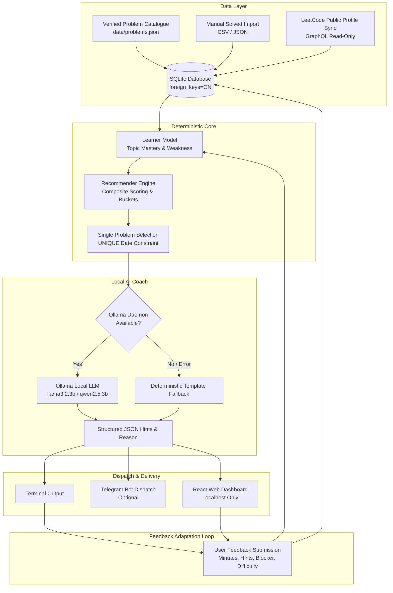

# DSA Mentor AI — System Architecture

## 1. Architectural Philosophy
DSA Mentor AI operates under a strict, non-negotiable architectural invariant:
- **Deterministic Python Core**: The sole source of truth for problem candidate filtering, weighted scoring, mastery calibration, one-per-day enforcement, and database writes.
- **Local AI Mentor (Ollama)**: Strictly constrained to explaining and structuring progressive hint ladders for an already selected problem. The LLM never hallucinates or decides problems, URLs, tags, or test cases.
- **Zero Cloud / Zero Recurring Fees**: Completely self-contained on local hardware using SQLite and local models.

## 2. Component Directory
| Component | Module | Responsibility |
|---|---|---|
| Configuration | `app/config.py` | Environment variable loader, scoring weights, secret scrubbing log filter |
| Database Manager | `app/db.py` | SQLite connection factory (`foreign_keys=ON`, `Row` factory, transactions) |
| Problem Catalogue | `app/catalogue.py` | Loads verified problem dataset, enforces non-invention of tags/difficulties |
| History Importer | `app/importer.py` | CSV/JSON ingestion, strictly dedupes by `problem_id`, raw copy archive |
| LeetCode Client | `app/leetcode_client.py` | Read-only public GraphQL sync, bounded retries, snapshot cache, partial response guard |
| Learner Model | `app/learner_model.py` | 5-signal weighted topic mastery with proportional redistribution |
| Pattern Analyzer | `app/pattern_analyzer.py` | Canonical DSA taxonomy tracking and coverage gap analysis |
| Recommender | `app/recommender.py` | Deterministic candidate evaluation, bucket allocation, tie-breaking |
| AI Mentor | `app/mentor.py` | Ollama client with JSON validation, input sanitizer, and template fallback |
| Notifier | `app/notifier.py` | Terminal and Telegram delivery with retry logic |
| Scheduler Job | `app/scheduler_job.py` | Daily orchestrator (sync -> select -> coach -> notify) |
| Local HTTP API | `app/api.py` | Localhost-only Flask API serving endpoints and React SPA |
| Web Dashboard | `dashboard/` | Responsive React + Vite UI with progressive hint disclosure & feedback |

## 3. Data Integrity & Trust Boundaries
1. **Append-Only Events**: User submissions and feedback sessions are recorded in `activity_events` as an immutable append-only event stream.
2. **UNIQUE(date) Constraint**: Guarantees exactly one recommendation per calendar day at the database engine level.
3. **Untrusted Code & Pastes**: User input submitted to the mentor or API is sanitized against prompt injection patterns and wrapped in `<user_untrusted_input>` blocks.
4. **Deterministic Tie-Breaking**: When candidates tie in composite score, a deterministic hash `sha256(date:problem_id)` breaks the tie identically across all machines.
